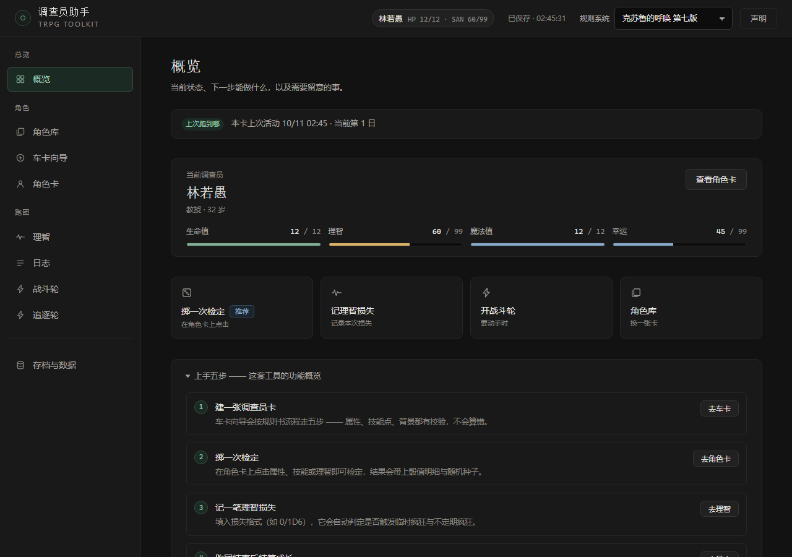
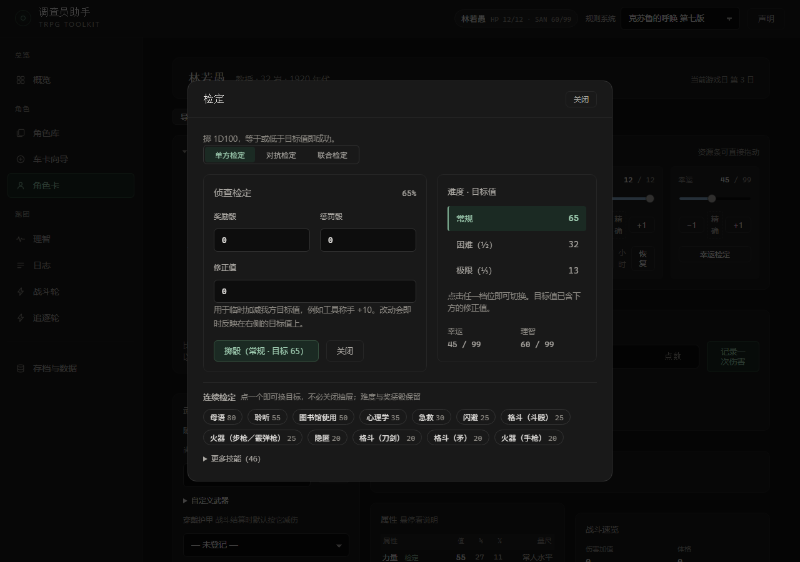

# 调查员助手 · 在线版

面向《克苏鲁的呼唤》第七版的跑团辅助工具。**零依赖、单文件** —— 点开即用，无需安装，无需联网；所有数据只保存在你自己的浏览器里。

## 打开方式

**在线使用（推荐）**

<https://p1anez.github.io/coc-toolkit/>

**离线使用**

在本仓库点开 `index.html`，用右上角的「Download raw file」按钮保存到本机，双击即可打开。不需要安装任何东西，也不需要联网。

## 能做什么

| 模块 | 说明 |
|---|---|
| **车卡向导** | 分五步创建调查员：基本信息 → 属性 → 技能点 → 背景 → 总览。全程校验（技能点上限、信用评级范围、年龄调整），**每一步都可以回退修改** |
| **角色卡** | 属性、技能、武器、装备集中在一页；资源条可直接拖动，每一次改动都写进日志 |
| **检定** | 点击属性、技能或理智即可发起；支持奖励 / 惩罚骰、难度档（常规 / 困难 / 极限）、**花幸运改判** |
| **理智** | 理智检定与损失结算、疯狂发作、恐惧症与躁狂症记录、幕间恢复 |
| **战斗轮** | 按敏捷排先手，攻击结算自动处理成功等级比较与伤害 |
| **追逐轮** | 按规则处理追逐中的移动与对抗 |
| **日志** | 每次检定都可回放（带骰值明细与随机种子）；技能成长一键结算 |
| **规则数据** | 职业表、武器表、毒剂表、物价表已内建，不必再翻规则书 |
| **存档与数据** | 角色导出 / 导入 JSON、多套配色、村规开关 |

> 完整流程见应用内的「上手五步」—— 那里列的操作是**活的**，会跟着版本一起更新。

## 数据存在哪里

所有数据保存在浏览器的本地存储（localStorage）里，不上传任何服务器。

- 换电脑、换浏览器，数据不会跟过去
- 清理浏览器数据会连同角色一并清掉
- 重要角色请在「存档与数据」页导出 JSON，单独留一份备份

## 关于本仓库

本仓库是**成品货架**：`index.html` 由源码仓库的发布脚本自动同步，**请勿直接修改它**（改动会在下次同步时被覆盖）。

`README.md`、`使用说明.txt` 与 `screenshots/` 是人工维护的文档与配图，**不参与同步** —— 可以放心编辑。

## 授权说明

本项目是**非官方**的同人作品，依据 Chaosium Inc 的 **Fan Material Policy** 使用其商标与版权内容。**非商业、非零售**；分发形态固定为网页，不提供可执行程序版本。

> This website uses trademarks and/or copyrights owned by Chaosium Inc/Moon Design Publications LLC,
> which are used under Chaosium Inc's Fan Material Policy. We are expressly prohibited from charging you
> to use or access this content. This website is not published, endorsed, or specifically approved by
> Chaosium Inc. For more information about Chaosium Inc's products, please visit www.chaosium.com.
